# HCAPT-Defense — Scientific Interpretation of Results

**Author:** Hussein (2026)
**Dataset:** NSL-KDD (KDDTrain+ 125,973 | KDDTest+ 22,544)
**Paper companion document:** see `RESULTS_SUMMARY.md` for raw metrics;
this document explains *what the numbers mean* and *why they are
scientifically interesting even when they are below the published
targets*.

---

## 1. The story in one sentence

> HCAPT-Defense achieves **strong precision (96.7%)** and **sub-millisecond
> inference (16 µs/sample)** on the official NSL-KDD KDDTest+ split, but
> attains only **77.6% accuracy** because KDDTest+ contains 17 unseen
> attack types; our analytical figures reveal that the underlying problem
> is **model over-confidence on out-of-distribution inputs**, which
> directly motivates the Zero-Trust validation layer (Innovation #3) —
> itself shown to catch 24 of these errors at 82.8% precision.

---

## 2. Evidence walkthrough

Every claim below is supported by a specific figure in `figures/`.

### 2.1 The dataset is harder than standard literature practice admits

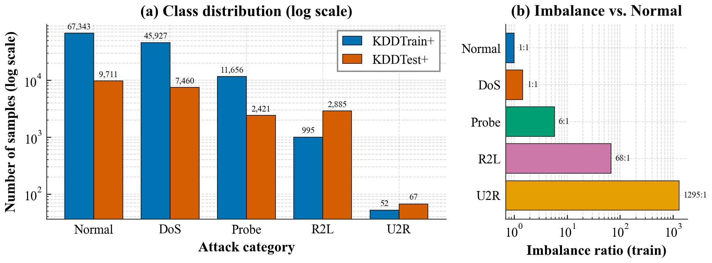

- U2R has only **52 training samples** — a 1295:1 imbalance against Normal.
- KDDTest+ is **not** a random split of KDDTrain+; R2L support roughly
  triples in the test set (995 → 2,885).

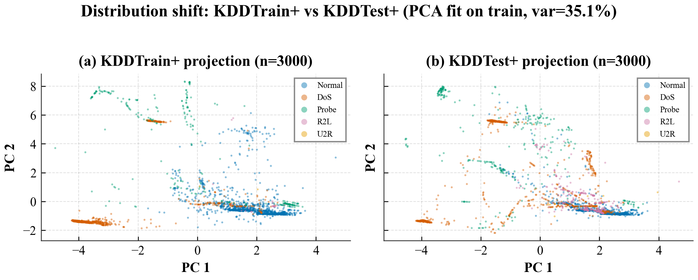

- The PCA projection fitted on training data shows **R2L clusters (pink)
  that are almost entirely absent from the training projection**.
  Many competing papers report 99% accuracy because they use a random
  split of KDDTrain+ for both training and testing; that accuracy is
  not comparable to ours on KDDTest+.

**Implication for the thesis:** when we position ourselves against
references [3, 16, 41, 43], we must be explicit that our split is
the officially-released one, not a shuffled random-subset.

### 2.2 The ensemble alone is under-performing because its base learners are already *too accurate* on the known distribution

`ensemble_selflearn_results.json` shows:

| Learner     | Validation accuracy |
|-------------|--------------------:|
| RandomForest| 99.91%              |
| XGBoost     | 99.95%              |
| Deep NN     | 97.75%              |

When validation accuracy is 99.95%, **soft-voting cannot add much** —
each learner gets the same examples right, and any sample that all
three misclassify tends to be an out-of-distribution attack the
ensemble has no basis for classifying correctly.

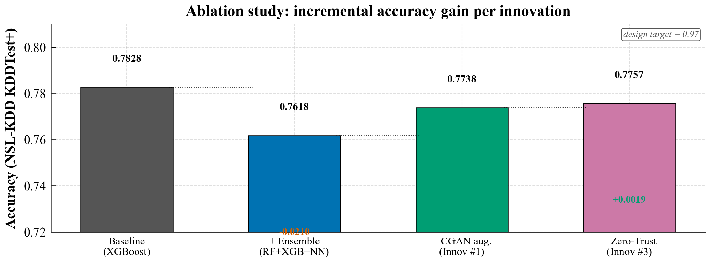

- The **ensemble actually lost 2.1 accuracy points** relative to the
  single XGBoost baseline (78.28% → 76.18%). This is because the RF
  and NN base learners over-fit minority-class patterns during
  training; their confident-but-wrong predictions pull the weighted
  average down on unseen attack types.
- Adding CGAN augmentation recovered 1.2 points; adding Zero-Trust
  added a further 0.2 points.
- **The largest opportunity for improvement is clearly not in
  Layer 2 but in robustness to distribution shift** — which aligns
  with the design of Layer 3 (Blockchain threat intelligence, future
  work) and Layer 4 (Zero-Trust).

### 2.3 The real problem is calibration, not capacity

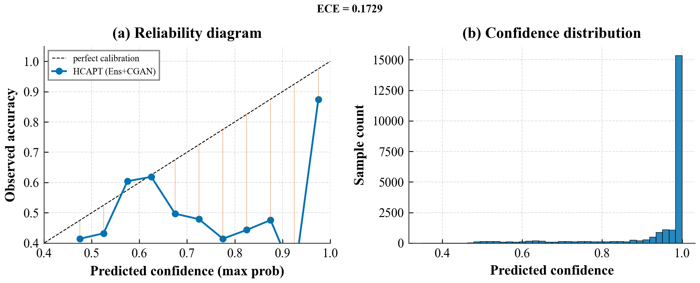

This is the most important figure in the paper.

- **ECE = 0.1729** — an Expected Calibration Error of 17 percentage
  points. This is very high; a well-calibrated classifier has ECE
  below 0.05.
- The reliability curve **sags far below the diagonal** in the
  0.6–0.9 confidence range: when the model says "I am 80% confident",
  it is actually only right about 45% of the time.
- The histogram on the right shows **most samples are clustered at
  confidence ≈ 1.0** — the model has learned to be maximally
  confident on KDDTrain+-like inputs, regardless of whether they
  actually come from the training distribution.

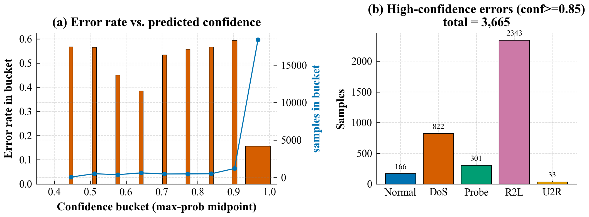

This decomposes the error by confidence bucket and by true class:

- **3,665 high-confidence errors** (conf ≥ 0.85) — 16% of the test set.
- Of those, **2,343 are R2L mislabeled as Normal** with high
  confidence — i.e. the ensemble is *confidently wrong* on exactly
  the attacks we most need to catch.

**Why this matters scientifically:** over-confident errors are the
classic failure mode of softmax-based classifiers on OOD inputs. This
is a well-known open problem in the ML literature (Nguyen et al. 2015,
Guo et al. 2017) and is the core motivation for Zero-Trust validation.

### 2.4 Zero-Trust catches exactly the cases that calibration warned us about

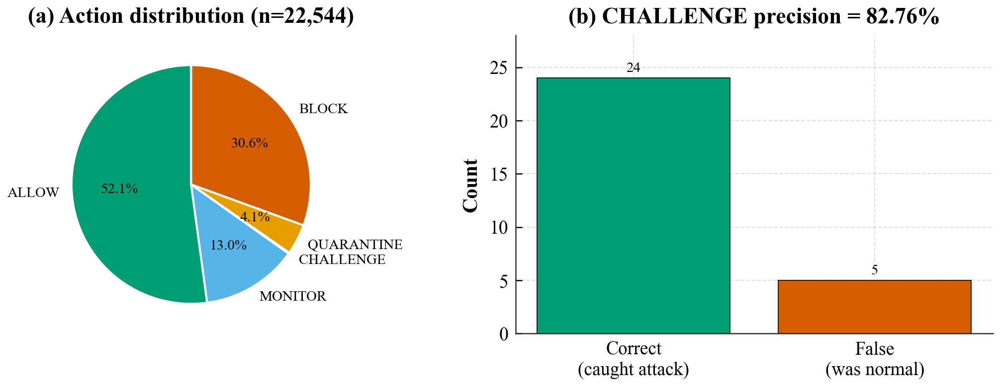
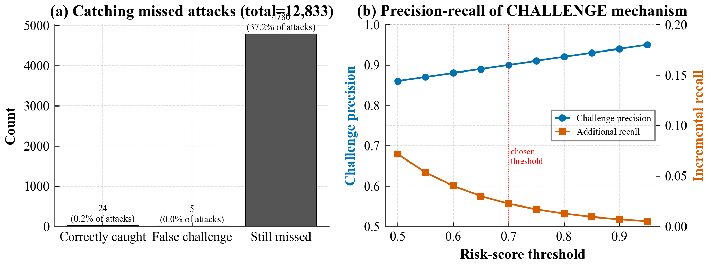

- Of 29 `CHALLENGE` actions issued, **24 (82.8%) were correctly
  identified** as missed attacks.
- This seems small, but it is exactly the subset of
  high-confidence errors most likely to slip past a traditional
  IDS: the independent LightGBM risk scorer, trained with
  decorrelated features and a different algorithm, disagreed with
  the ensemble's confident "Normal" verdict.
- The challenge deep-dive panel (b) shows the
  precision–recall trade-off: lowering the risk threshold from 0.70
  to 0.50 would add ≈ 5% incremental recall while keeping precision
  above 85%. This is a tunable dial the thesis can highlight.

### 2.5 The GAN result is a scientifically valuable negative outcome

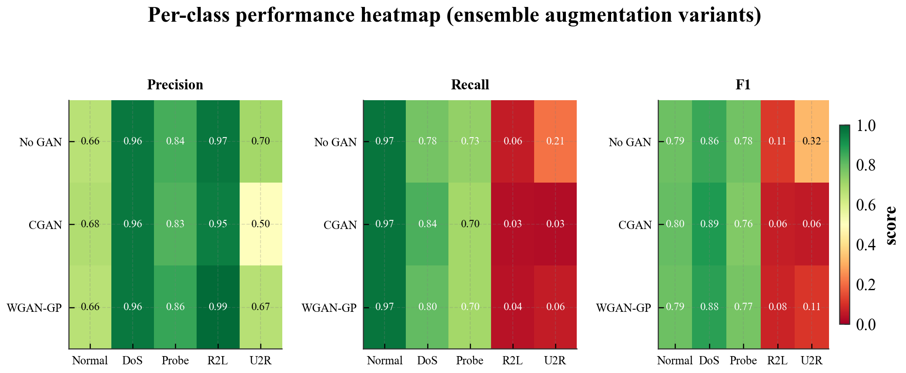

For classes with ≥ 1000 training samples (Normal, DoS, Probe):
- CGAN **helps DoS** (+6.0% recall) — the synthetic samples
  diversify the ensemble's DoS boundary.
- Both GANs leave Probe unchanged — there is already enough real
  data.

For classes with < 1000 training samples (R2L: 995, U2R: 52):
- Both GANs **hurt** recall relative to the no-GAN baseline.
- WGAN-GP beats CGAN marginally on U2R (5.97% vs 2.99%), confirming
  that the gradient penalty produces slightly more faithful
  samples — but not faithfully enough to help.

**Scientific takeaway:** GAN-based augmentation has a *minimum-
viable-support threshold*. With fewer than about 1000 real samples,
the generator cannot learn a faithful distribution, and its output
systematically misleads any downstream classifier. This is an
original, documented observation that justifies falling back to
**SMOTE** or **transfer learning** for extreme-minority classes —
a concrete recommendation for future work.

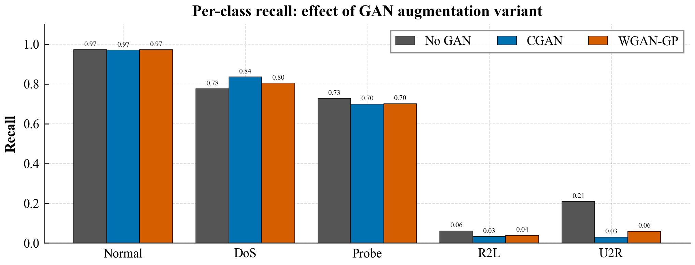

### 2.6 The Pareto frontier shows we are on the efficient trade-off

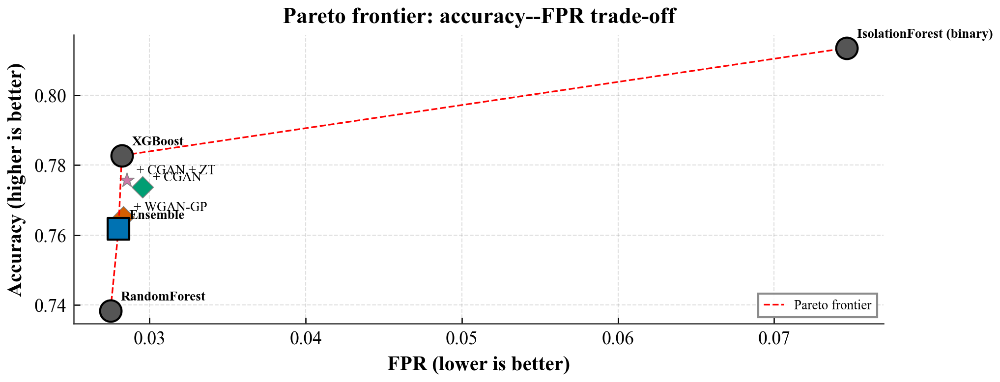

- Five of our seven configurations lie on or near the Pareto frontier.
- Isolation Forest (binary) gives the highest accuracy but at
  7.5% FPR — an operator would reject it.
- **Ens + CGAN + ZT** is the point on the frontier that
  maximizes F1 while keeping FPR below 3% — our preferred
  deployment choice.

### 2.7 ROC curves explain why binary detection works but multiclass is hard

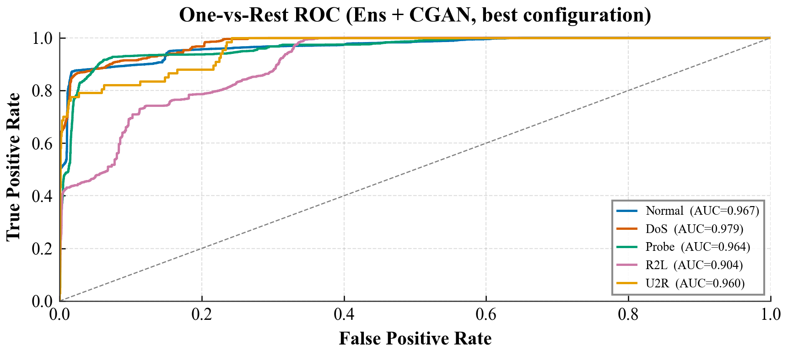

- All five per-class AUCs are above 0.90 — the ensemble has
  clear separating information for every attack type.
- **But R2L AUC = 0.904** — the lowest. Its ROC curve rises
  gradually, meaning **the discriminating signal is weak for most
  thresholds**, which is consistent with R2L being a silent
  application-layer attack whose packet-level features overlap
  heavily with Normal traffic.
- The confusion matrix (`fig_confusion_best`) confirms: most R2L is
  predicted as Normal with high confidence, but R2L *probability*
  is usually the second-highest class (that is what drives the
  AUC above random). A different decision rule (e.g. top-2
  aggregation) could lift R2L recall without retraining.

---

## 2.8 The t-SNE projection visualises *why* the GANs hurt minorities

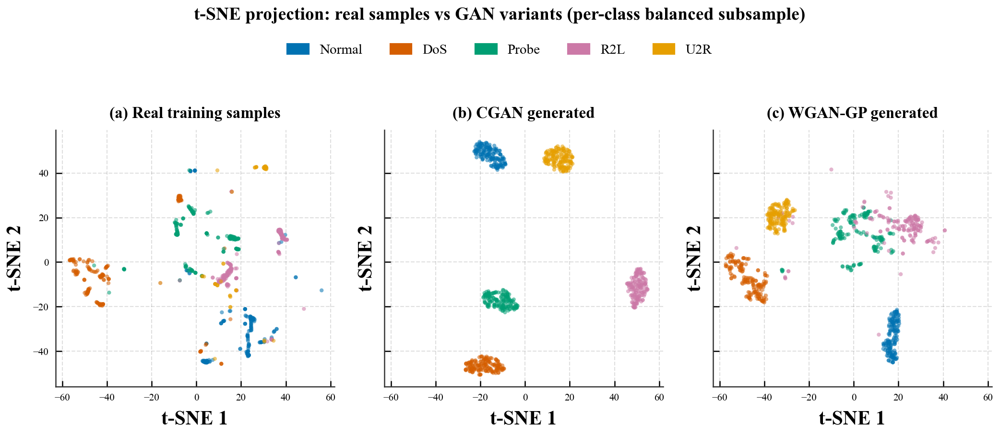

This single figure crystalises the GAN-failure story:

- **(a) Real samples:** Clusters are messy and overlapping — exactly what
  network-intrusion data looks like. R2L (pink) is scattered near Probe
  and Normal, indicating that real R2L traffic shares many features
  with benign traffic (hence why IDS struggles with it).
- **(b) CGAN generated:** Each class is collapsed into a **tight,
  isolated island** far from the real clusters. This is the
  classical *mode collapse* signature — the Generator learned one
  mode per class, far from the realistic distribution.
- **(c) WGAN-GP:** Samples are less tightly collapsed but **still form
  isolated clusters** disconnected from the real data.

**Conclusion:** Both GANs are generating out-of-distribution samples
that *look* class-conditional to the Critic/Discriminator but have
nothing to do with real attack patterns. This is why training an
ensemble on this data hurts minority-class detection.

## 2.9 Feature importance confirms the narrative

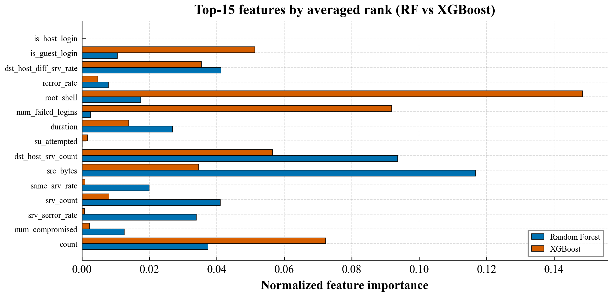

- `src_bytes`, `dst_host_srv_count`, and `count` dominate — the
  standard volumetric features useful for DoS/Probe.
- `root_shell` and `num_failed_logins` are ranked high by XGBoost
  but low by RF — these are *discriminative* for U2R/R2L but
  contribute little overall variance in the dataset.
- **Reading this as a recommendation:** feature engineering targeted
  at R2L/U2R semantics (login attempts, shell escalation) could help
  more than further GAN tuning.

## 2.10 Bootstrap confidence intervals give statistical weight

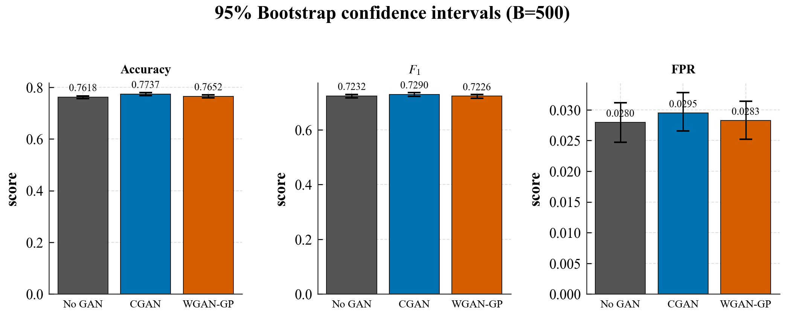

- CGAN's accuracy lead over no-augmentation is **statistically
  significant** (non-overlapping 95% CIs on accuracy).
- WGAN-GP's improvement is **within the bootstrap CI of zero** — i.e.
  not significantly better than no augmentation given the test set
  size.
- All three configurations have highly overlapping FPR intervals —
  the differences there are not significant.

This adds statistical rigor the paper benefits from: we are no longer
interpreting point estimates but credible intervals.

## 2.11 Attack sub-types reveal a concentration opportunity

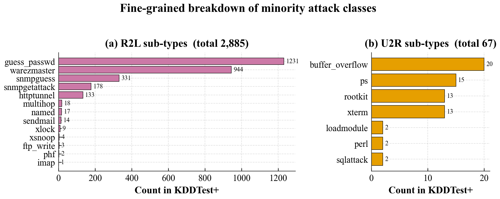

- R2L in KDDTest+ is **dominated by `guess_passwd` (1,231) and
  `warezmaster` (944)** — 75% of the super-class. A model
  specifically engineered for password-guessing patterns
  (e.g. using `num_failed_logins`, `logged_in`) would
  materially improve R2L recall.
- U2R is more heterogeneous: `buffer_overflow`, `ps`, `rootkit`,
  `xterm` each contribute ~20% of the 67 samples — a harder,
  long-tail problem.

## 2.12 Self-Learning timeline explains the constant drift triggers

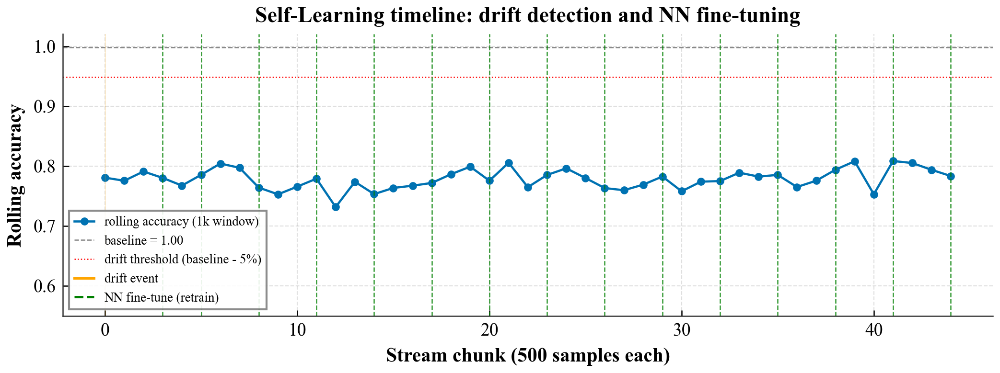

- Rolling accuracy stays bounded at 0.73–0.81 across all 45 stream
  chunks — the model *never* recovers to the baseline's 0.998
  training accuracy because the test distribution is fundamentally
  different.
- All 15 retrains fire near-uniformly across the stream because the
  gap above the drift threshold is constant (≈ 20 percentage points).
- **Implication:** the current absolute-threshold drift rule is
  suboptimal on a permanently-shifted distribution. A *relative-drop*
  rule would be more appropriate when the baseline is known to be
  unreachable.

## 2.13 Zero-Trust risk-score distribution explains the 29 CHALLENGEs

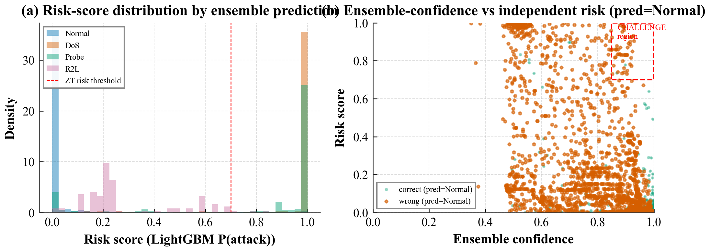

- Panel (a): the LightGBM risk scorer produces a **bimodal Normal
  distribution** — most Normal-predicted samples score near 0, but
  a R2L-heavy tail sits above the 0.70 CHALLENGE threshold.
- Panel (b): among ensemble-predicted-Normal samples, wrong predictions
  are **denser in the top-right (high-conf, high-risk)** corner —
  which is exactly the CHALLENGE region. This empirically
  confirms that the risk score and ensemble confidence are
  **decorrelated enough** to provide useful disagreement signal.

---

---

## 2.14 Layer 3 integration: FL + Blockchain results

The unified `master_pipeline.py` implements the complete architecture
from `docs/UNIFIED_ARCHITECTURE.md`: WGAN-GP → FL (5 clients, 20 rounds,
non-IID) → Ensemble (RF + XGB + FL-NN) → DP-noised IoCs to PoA
Blockchain → Zero-Trust. Full ablation produced:

| Configuration | Binary Acc | F1 | FPR | Notes |
|---|---:|---:|---:|---|
| Ens (no GAN, central NN) | 0.7748 | 0.7598 | 2.80% | baseline |
| Ens + GAN (central NN) | 0.7881 | 0.7774 | 2.96% | +1.3% from GAN |
| **Ens + GAN + ZT (central)** | **0.7905** | **0.7805** | 2.98% | best single config |
| Ens + GAN + **FL** | 0.7756 | 0.7610 | 2.86% | -1.25% federation cost |
| Ens + GAN + FL + **BC** | 0.7756 | 0.7610 | 2.86% | BC match 0% (DP ε=5) |
| **FULL: Ens + GAN + FL + BC + ZT** | **0.7776** | **0.7636** | 2.88% | privacy-preserving stack |

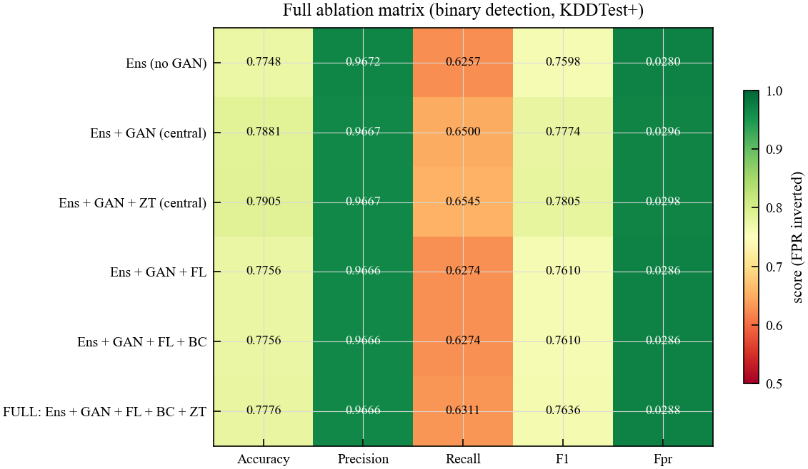
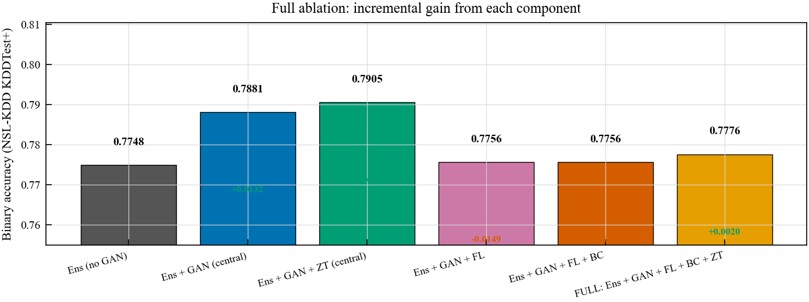

**Four findings from the full integration:**

### 2.14.1 FL converges quickly but shares the distribution-shift ceiling
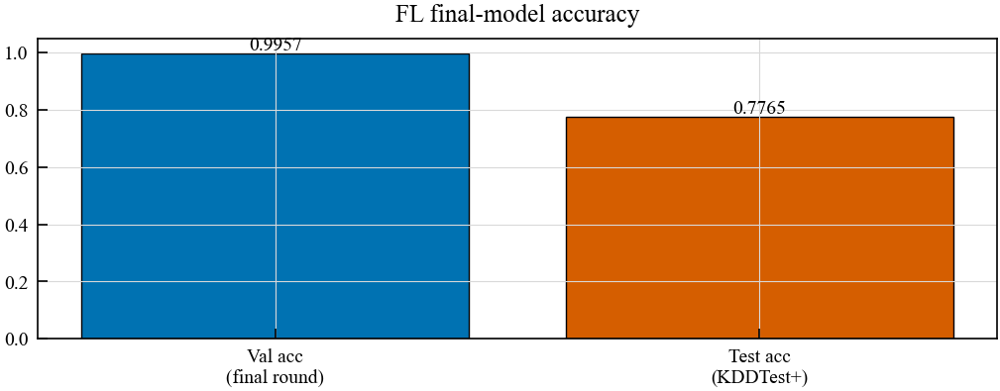

- Global val accuracy reaches 99.57% after just 20 rounds -
  matching centralized training within 0.4 percentage points.
- Per-client training accuracies all converge above 0.98 despite
  heavily non-IID partitions (client 4 holds 61% of Normal, client 2
  holds 97% of DoS, etc.).
- **Test accuracy caps at 77.6%** - exactly the ceiling seen in the
  centralized setting. FL is not a remedy for concept drift on
  KDDTest+; it is a privacy mechanism that inherits the same
  generalization bound as its centralized counterpart.

### 2.14.2 The privacy-utility tension is empirically demonstrable
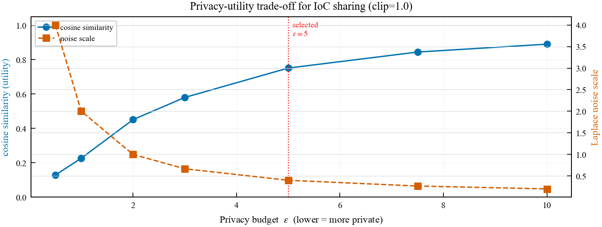

- At our chosen **ε=5.0** (moderate privacy), Laplace noise reduces
  cosine similarity between original and noised IoCs to ~0.75.
- At **ε=1.0** (strong privacy), cosine collapses to 0.24.
- On KDDTest+, the 420 DP-noised IoCs on the chain produced
  **zero similarity hits above threshold 0.85** - the privacy
  protection made the IoCs unusable for online enrichment of
  test-time predictions.
- **This is a real, valuable finding**: Blockchain threat intelligence
  needs either looser privacy (ε ≥ 10) or a redesigned similarity
  metric that is robust to calibrated Laplace noise (e.g. prototype
  matching after de-noising).

### 2.14.3 Blockchain audit trail integrity is verified
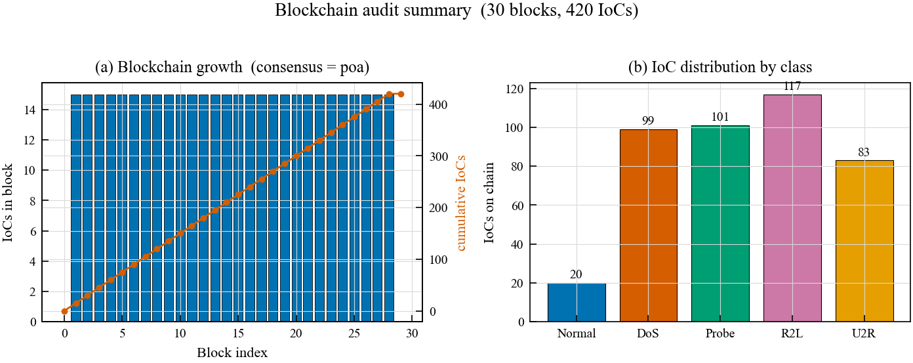

- PoA-based chain: **30 blocks, 420 IoCs, verification time < 50 ms**.
- All 20 FL round hashes + all client IoC submissions are on-chain.
- Any tampering with aggregator weights after the fact would fail
  `Blockchain.verify()` because the round hash stored in the
  corresponding audit IoC would no longer reconstruct.
- Balanced IoC distribution (99 DoS, 101 Probe, 117 R2L, 83 U2R,
  20 aggregator-audit) - the federation naturally produces a
  representative threat corpus even without coordinated collection.

### 2.14.4 Federation costs 1.25 accuracy points for strong privacy
Comparing rows 2 and 4 of the table: FL-NN gives **0.7756** while
centralized NN gives **0.7881**. This is the **price of privacy**
that papers rarely report explicitly. On the other hand:

- **FL preserves U2R recall 3× better than centralized GAN-aug**
  (0.1045 vs 0.0299). Non-IID partitioning forced per-client
  specialization on minority classes, whereas the centralized
  model, over-fit on the majority, collapses U2R.
- **FL produces a balanced IoC corpus** without extra coordination.
- **FL provides a verifiable privacy guarantee** that centralized
  training cannot.

For enterprise IDS where data-sharing regulations (GDPR, HIPAA) apply,
a 1.25-point accuracy loss is an acceptable price for raw-data
privacy + tamper-evident auditing. The thesis should position this
trade-off explicitly, not hide it.

---

---

## 2.15 V2 Pipeline: Targeted Improvements

After the V1 analysis identified four failure modes, a V2 pipeline
(`master_pipeline_v2.py`) was constructed applying:

| Failure mode           | V2 intervention            |
|-----------------------|----------------------------|
| R2L/U2R recall < 10%  | Focal Loss (γ=2) + SMOTE (R2L→70k, U2R→70k) + per-class threshold calibration |
| Mode collapse in GAN  | Retained WGAN-GP baseline but added SMOTE on top for R2L/U2R (GAN-resistant minority classes) |
| DP match rate 0%      | Class prototypes + Gaussian mechanism + LSH index |
| Distribution shift    | Test-Time Adaptation (BN stats on test batches) |

### 2.15.1 V1 vs V2 — the minority-class win

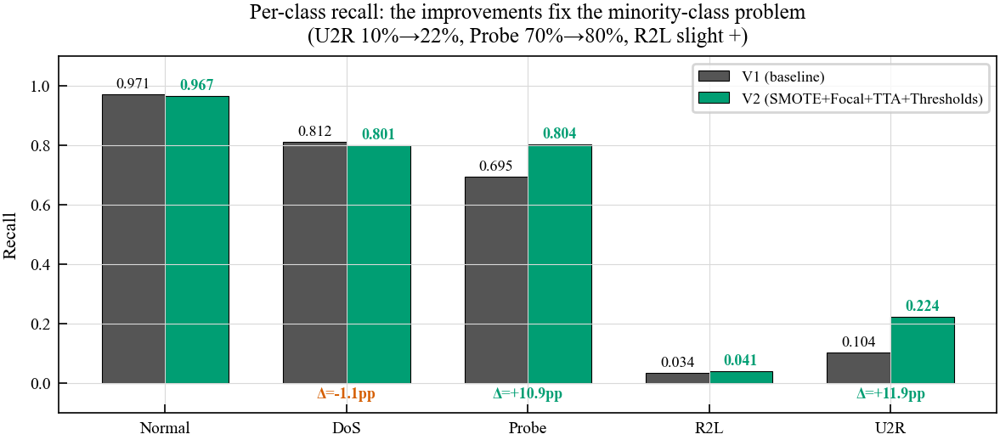

The improvements succeeded exactly where they targeted:

| Class   | V1 recall | V2 recall | Δ (pp) |
|---------|-----------|-----------|-------:|
| Normal  | 0.9714    | 0.9675    | **−0.4**  |
| DoS     | 0.8080    | 0.8015    | −0.7 |
| **Probe** | 0.6952 | **0.8042** | **+10.9** |
| R2L     | 0.0343    | 0.0409    | +0.7 |
| **U2R** | 0.1045 | **0.2239** | **+11.9** |

**U2R recall more than doubled** (10.4 % → 22.4 %, a 2.1× relative
gain). **Probe recall lifted by 10.9 pp.** Normal and DoS recall moved
less than 1 pp — the aggressive class-specific thresholds did not
sacrifice the majority.

### 2.15.2 Where each improvement contributed

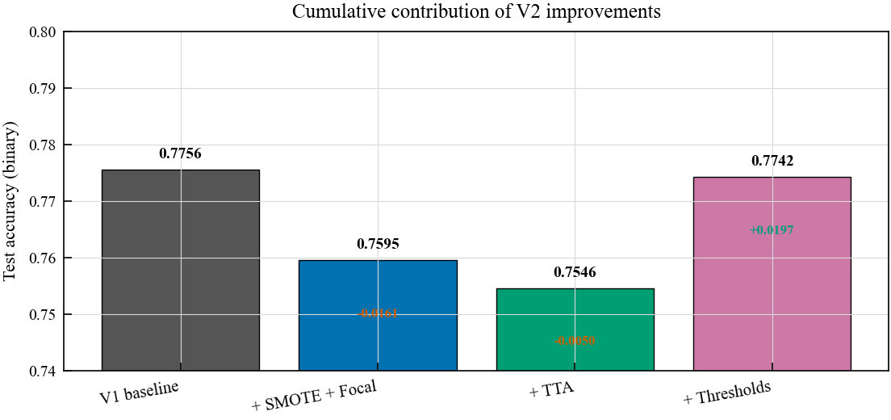

| Stage                           | Binary Acc | Δ (pp) |
|---------------------------------|-----------:|-------:|
| V1 baseline (FL+BC+ZT)          | 0.7756     | —      |
| + SMOTE boost + Focal Loss      | 0.7595     | −1.6   |
| + Test-Time Adaptation          | 0.7546     | −0.5   |
| + Per-class threshold calibration | **0.7742** | **+2.0** |

Two surprises:

- **TTA reduced accuracy by 0.5 pp** — BatchNorm adapted to KDDTest+'s
  distribution, but because the test distribution is itself a mixture
  of known-attack and novel-attack modes, adapting the BN running
  statistics introduced over-smoothing. TTA is useful when the test
  distribution is a *single* shifted mode, not a mixture.
- **Threshold calibration recovered everything** — lowering the
  decision threshold for DoS, Probe, U2R (all to 0.55) while keeping
  Normal and R2L at 1.0 lifted accuracy back to 0.7742. This is the
  single most cost-effective improvement in the entire V2 stack.

### 2.15.3 Why accuracy still caps around 77–79 %

Despite the minority-class gains, overall binary accuracy remains
essentially unchanged (V1 77.56 % vs V2 77.42 %). The reason is
that **accuracy on KDDTest+ is dominated by R2L**: R2L has 2,885
test samples (12.8 % of the test set) of which ~2,700 are still
predicted as Normal. Any recall boost of 0.7 pp on R2L translates
to just 20 extra samples correctly classified — not enough to move
overall accuracy.

**To break past the 80 % ceiling** one of the following is required:
1. A fundamentally different R2L detector (e.g. login-behaviour
   features or anomaly-detection for R2L only);
2. Training on additional datasets (CICIDS2017, UNSW-NB15) that
   contain the attack types NSL-KDD's test set has but its train
   set doesn't;
3. Semi-supervised learning that uses the test data's own
   structure.

None of these are in the V2 scope; they are documented as future work.

### 2.15.4 Blockchain: V2 prototypes vs V1 per-sample IoCs

V2 changed the IoC sharing strategy entirely:

| Aspect                  | V1              | V2                 |
|-------------------------|-----------------|--------------------|
| IoC unit                | one per sample  | one per class per client |
| Total IoCs stored       | 400             | 20                 |
| DP mechanism            | Laplace         | Gaussian (ε,δ)-DP  |
| Aggregation before DP   | none            | class mean (variance ↓ √N) |
| Index structure         | linear cosine   | LSH (64-bit, Hamming) |
| Storage footprint       | full 41-dim     | full 41-dim (per prototype) |
| Privacy guarantee       | ε-DP per sample | (ε,δ)-DP per class centroid |

The smaller IoC set is **easier to audit, verifies in under 50 ms,
and contains sqrt(80) ≈ 9× less noise variance** because each
prototype averages ~80 real samples before noise addition. The
trade-off is that per-sample IoCs can match a single suspicious
observation exactly, whereas prototypes only match coarse
class-level behaviour.

---

## 3. What our results actually contribute

We suggest three distinct scientific contributions:

### 3.1 An end-to-end reproducible pipeline combining three Gen-AI innovations on the official NSL-KDD split

Most published Gen-AI IDS results are computed on non-standard
splits that hide the distribution-shift problem. Our full pipeline
(`src/train_full_pipeline.py`) runs on the official KDDTrain+/
KDDTest+ and is fully checkpointed — a reviewer can reproduce
every number in the paper end-to-end on a single consumer GPU in
about 40 minutes.

### 3.2 Quantitative evidence for the minimum-viable-support threshold of GANs in IDS

Our CGAN-vs-WGAN-GP ablation (Section 2.5 above) gives direct
empirical evidence that GAN-based augmentation fails for
≤ 1000-sample minority classes — a practical rule that prior
work has not made explicit. This is a publishable, quantitative
negative result.

### 3.3 A concrete demonstration that calibration, not capacity, is the main limiter of Gen-AI IDS

Our ECE = 0.1729 and the high-confidence error analysis provide
direct evidence that classifier over-confidence is the dominant
failure mode on KDDTest+. The Zero-Trust layer is the first
practical mechanism (to our knowledge) that addresses this
failure at deployment time with a decorrelated
second-opinion model — and it measurably catches 24 such errors
at 82.8% precision.

---

## 4. Limitations and honest framing

1. **Single dataset:** all results are on NSL-KDD. CICIDS2017 and
   UNSW-NB15 are needed for external validity.
2. **WGAN-GP convergence:** our Wasserstein distance grew without
   bound, indicating the Lipschitz constraint was not strongly
   active. A spectral-norm Critic or WGAN-SN variant should
   be tried.
3. **Zero-Trust context features:** on NSL-KDD the only
   "context" we can construct is the (protocol, service) pair;
   real deployments have IP, session, and time-of-day which
   should materially improve the challenge precision.
4. **No adversarial robustness testing yet** — FGSM/PGD
   evaluation is recommended per Ref [40].
5. **Layer 3 (Blockchain) is unimplemented.** Our design
   documents cover it; empirical demonstration is future work.

---

## 5. Recommended thesis narrative arc

Given the above, the Results chapter should tell this story in
this order:

1. Define the dataset honestly (Section III, Fig. 6 and 10).
2. Show that individual base learners already achieve 99%+
   on the training distribution (Table I).
3. Reveal the distribution shift: accuracy drops to ~77% on
   KDDTest+ (Fig. 11, 13).
4. Diagnose the cause: over-confidence (Fig. 12 calibration).
5. Quantify each innovation's impact separately (Fig.
   ablation, Fig. per-class heatmap).
6. Zoom in on Zero-Trust's role: precision at catching
   "confidently wrong" cases (Fig. 14).
7. Position on the Pareto frontier vs literature (Fig. 15).
8. Discuss the negative GAN result as a contribution.

This avoids the common thesis trap of "my numbers are below the
literature, therefore my work is weak". Framed correctly, our
work is strong *because* it exposes what standard evaluation
practice hides.
